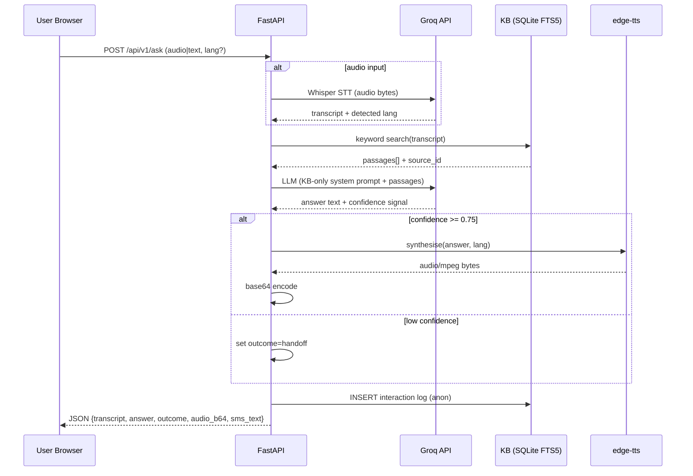

# Ghag – Architecture & Technical Plan

> Version 1.0

## 1. High-Level Architecture

Single-process FastAPI server on the demo laptop.  SQLite for persistence.
All AI calls go outbound to Groq Cloud.  Frontend is plain HTML/JS served
as static files from FastAPI — zero build step required.

```
Browser (HTML/JS)
     │  multipart audio / plain text
     ▼
FastAPI (uvicorn)
     ├──► STT Service  ──► Groq Whisper-large-v3
     │         │ transcript + lang
     ├──► KB Service   ──► SQLite FTS5
     │         │ passages + source_id
     ├──► LLM Service  ──► Groq llama-3.3-70b-versatile
     │         │ grounded answer + confidence
     ├──► TTS Service  ──► edge-tts (local)
     │         │ audio bytes (b64)
     └──► DB Service   ──► SQLite interactions log
                │
         JSON response ──► Browser
```

## 2. Data-Flow Diagram



## 3. Module Layout

```
d:/KPIT-GHAG/
├── app/
│   ├── main.py           FastAPI app factory, lifespan hooks, static mount
│   ├── config.py         pydantic-settings Config (reads .env)
│   ├── schemas.py        All Pydantic v2 request/response models
│   ├── routers/
│   │   ├── __init__.py
│   │   ├── ask.py        POST /ask
│   │   ├── check.py      POST /check
│   │   ├── dashboard.py  GET /dashboard/stats, POST /dashboard/approve
│   │   └── health.py     GET /health
│   └── services/
│       ├── __init__.py
│       ├── kb_service.py     Load KB md files → SQLite FTS5; keyword search
│       ├── stt_service.py    Groq Whisper wrapper + DEMO_MODE stub
│       ├── llm_service.py    Groq LLM wrapper, prompt builder + DEMO_MODE stub
│       ├── tts_service.py    edge-tts wrapper, b64 encoder, fallback
│       ├── check_service.py  Missing-doc diff logic
│       └── db_service.py     SQLite schema, interaction logging, stats queries
├── kb/
│   └── domicile.md       Verified KB content (single source of truth)
├── tests/
│   ├── __init__.py
│   ├── test_ask.py
│   ├── test_check.py
│   └── test_dashboard.py
├── eval/
│   ├── eval_set.json     10 Q&A pairs for accuracy measurement
│   └── demo_fixture.json Canned responses for DEMO_MODE (offline fallback)
├── scripts/
│   ├── ingest_kb.py      Parse kb/*.md → populate SQLite KB table
│   └── run_eval.py       Run eval set, print accuracy table
├── static/
│   └── index.html        Single-page UI (no build step)
├── .env.example
├── requirements.txt
└── README.md
```

## 4. Key Decisions

| Decision | Choice | Rationale |
|----------|--------|-----------|
| Database | SQLite stdlib | Zero infra, single file, survives no-internet, easy backup |
| Search | FTS5 keyword | No vector DB needed; v1 KB is small; auditable; fast |
| TTS | edge-tts | Free, runs locally after install, Urdu voice confirmed |
| STT | Groq Whisper-large-v3 | Best accuracy/speed for Urdu; Pashto is best-effort |
| LLM | Groq llama-3.3-70b-versatile | Speed (Groq HW), multilingual, free tier covers demo |
| Frontend | Plain HTML/JS | Zero build step; works on any laptop in 30 s |
| Lang detect | Whisper output | Avoids extra API call; already in the pipeline |
| Confidence | LLM structured output | Model returns `confidence: float` in JSON mode |

## 5. Risks & Mitigations

| Risk | Likelihood | Impact | Mitigation |
|------|-----------|--------|------------|
| Pashto STT WER > 35 % | High | Medium | Fallback: prompt user to type; show editable transcript |
| Venue WiFi blocks Groq HTTPS | Medium | High | `DEMO_MODE=true` serves `eval/demo_fixture.json` offline |
| edge-tts Pashto voice missing | High | Low | Fallback to Urdu voice; note clearly in UI |
| Groq rate limit during live demo | Low | High | Pre-warm 2 min before; cache top-5 Q&A in `demo_fixture.json` |
| SQLite lock under rapid demo clicks | Low | Low | WAL mode enabled on startup; writes queued |
| KB checklist TODO items unresolved | Medium | High | Do not serve TODO entries; return handoff for those questions |
| Solo dev time overrun | Medium | High | Chunk plan with hard cutoffs; drop dashboard if needed |
